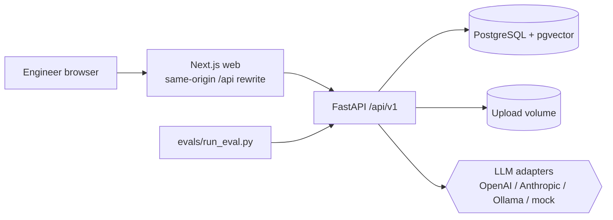

# Architecture

ResolveAI is a modular monolith: one Next.js web app, one FastAPI service, one PostgreSQL database with pgvector.

| Layer | Location | Responsibility |
|---|---|---|
| Web | `apps/web` | Login, Knowledge Base, Assistant (citations), Incidents, RCA editor, Ops metrics. Browser only talks to its own origin; the API URL stays server-side. |
| API routes | `services/api/app/api` | Auth, ownership checks, request validation, typed errors. |
| Core | `services/api/app/core` | Settings + startup validation, DB session, JWT/bcrypt, redaction, rate limits, structured logging. |
| Models | `services/api/app/models` | SQLAlchemy 2 entities for every PRD §7 table plus `request_logs`. One Alembic migration. |
| Ingestion | `app/services/ingestion` | Upload sniffing, PDF/TXT/MD extraction with page numbers, page-aware chunking, hash dedup, batched embeddings. |
| Retrieval | `app/services/retrieval` | Owner-filtered pgvector cosine search, grounded answer orchestration, server-side citation validation, abstention. |
| LLM | `app/services/llm` | `ChatProvider` / `EmbeddingProvider` interfaces, adapters, pricing table, usage recording, versioned prompts. The only place provider-specific code exists. |
| Incidents / RCA | `app/services/incidents`, `app/services/rca` | Deterministic observation extraction, structured analysis validation, unsafe-command filtering, RCA drafting, confirmation rules, Markdown export. |

## Request flows

**Ingestion.** `POST /documents` validates size, extension and magic bytes, stores the file under a random name, creates a `queued` document and returns 202. A FastAPI background task extracts text per page, chunks (≈550 tokens, 100 overlap, never across pages), skips duplicate chunk hashes, embeds in batches with retry, and marks the document `ready` or `failed` with an error code.

**Grounded chat.** The question is embedded, the top-k chunks *for the caller only* are retrieved, and chunks below the similarity threshold are dropped. With no usable evidence the API abstains without calling the LLM. Otherwise chunks are wrapped as untrusted `<chunk>` data and the model must return JSON `{answer, citations:[{chunk_id, quote}], abstain}`. Every citation is checked server-side: the chunk must be one of the retrieved ones and the quote must occur in its stored text. An answer that loses all its citations becomes an abstention.

**Incident analysis.** Logs are redacted (secrets, tokens, emails, public IPs) before storage. Observations are extracted deterministically from the sanitized log with line numbers; the LLM adds hypotheses and read-only verification steps referencing those observation IDs. The validator forces every hypothesis to `suspected`, drops unknown evidence IDs, and moves destructive commands into `safety_warnings`.

**RCA.** Drafts always start `DRAFT` / `UNCONFIRMED` with an empty `confirmed_cause`. Only `POST /rca/confirm` with `reviewer_acknowledgement: true`, a non-empty confirmed cause and at least one evidence item sets `CONFIRMED`, recording reviewer and timestamp. Editing afterwards resets it to `UNCONFIRMED`.

## Data

All user-owned tables carry `owner_id`; every query filters by it and cross-user access returns 403 (or 404 for chunks reached through another user's document). `chunks.embedding` is `vector(EMBEDDING_DIM)` with an HNSW cosine index. Document deletion cascades to chunks and removes the stored file. See `services/api/alembic/versions/` for the schema.
